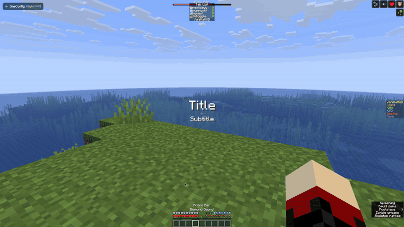
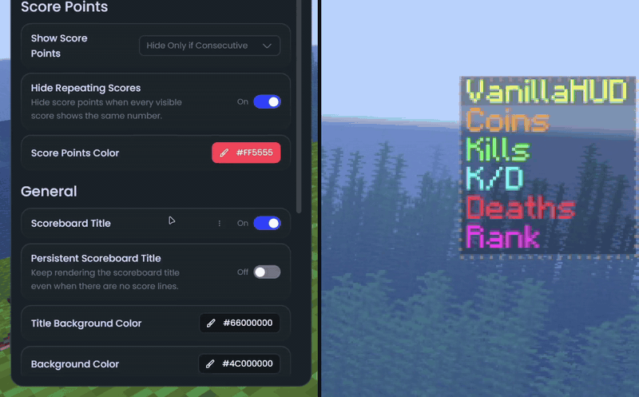

# VanillaHUD

VanillaHUD turns the parts of Minecraft's own HUD into elements you can move, scale and hide. It covers the hotbar, action bar, held item tooltip, title, scoreboard, tab list and boss bar.

### Hotbar

The hotbar moves together with the health, hunger, armor, air, mount health and experience displays.

Neat features:
- Animate the selected slot highlight between slots!
- Turn off the health bar animation on damage and healing, and the hunger bar shake (replicates 1.7)
- Always show hardcore hearts!
- Hide the experience bar or the experience level
- Draw the locator bar's waypoints over the experience bar

### Action bar

- Turn off the rainbow color that the "Now Playing" text uses when a jukebox starts

### Held item tooltip

- Keep the item name on screen all the time, or make it disappear without a fade

### Title and subtitle

- "Auto Scale" to shrink titles that go out of window bounds

### Scoreboard

- Hide the red score numbers (always, or only when they're just consecutive numbers)
- Hide the numbers when every line has the same score
- Change the color of the score numbers
- Hide the scoreboard title, or keep it on screen when there are no lines
- Custom background colors for the title and the body
- Use a PNG image as the scoreboard background
- Text shadow

### Tab list

- Animate the tab list opening and closing
- Hold or toggle mode for the tab key
- Limit how many players are shown
- Show ping as a colored number (you pick the color for each range)
- Hide the fake ping values some servers send
- Hide the header, the footer, the player heads or the ping
- Put yourself at the top of the list
- Custom background colors for the header, body, footer and player rows
- Turn off the text shadow

### Boss bar

- Hide the boss name or the health bar

### Status effects and closed captions

These two only exist on the Fabric versions.

- Move, scale or hide the status effect icons
- Move, scale or hide the closed captions
- Custom text color, background color and text shadow for the captions

## Supported versions

- Minecraft 1.8.9 on Ornithe.
- Minecraft 1.21.1-26.3 on Fabric.

VanillaHUD needs [OneConfig](https://modrinth.com/mod/oneconfig) and Fabric Language Kotlin. The Fabric builds also need Fabric API.

## Support

- Report bugs and ask questions on the [Polyfrost Discord](https://polyfrost.org/discord).
- Check [Polyfrost Status](https://status.polyfrost.org/) if a Polyfrost service is down.
